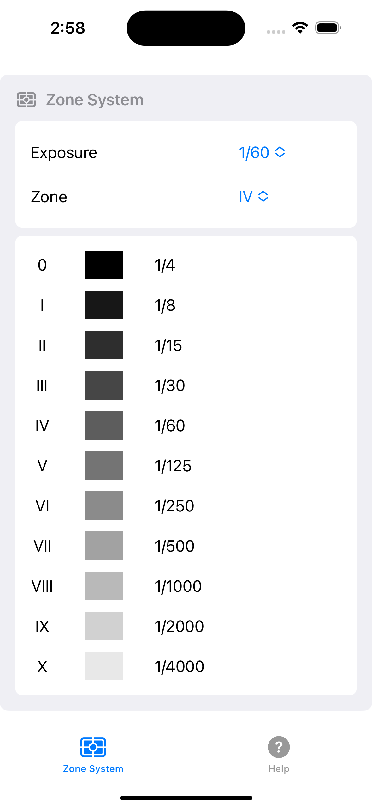
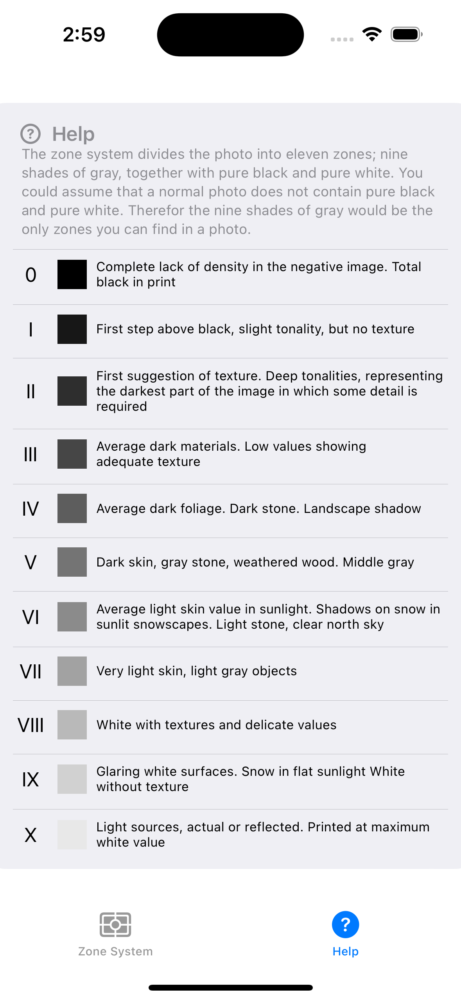

# Zone System: iOS app

The Zone System is a photographic technique for determining optimal film exposure and development, formulated by Ansel Adams and Fred Archer.(src: https://en.wikipedia.org/wiki/Zone_System). The system divides the photo into eleven zones; nine shades of gray, together with pure black and pure white. You could assume that a normal photo does not contain pure black and pure white. Therefor the nine shades of gray would be the only zones you can find in a photo.

This app aims to provide photographers with tools to enable using/applying zone system while on the field.

## Version 1 goals

The tool will return exposure values against the eleven zones, aligning the user selected exposure value against the user selected zone. This implementation essentially displays the "window" of array values from exposures after aligning the selected exposure to zone as the pivot.

e.g. If the user selects an exposure value of 1/60 seconds against zone III, the tool will return the following exposure values:

```
0     1/8
I     1/15
II    1/30
III   1/60
IV    1/125
V     1/250
VI    1/500
VII   1/1000
VIII  1/2000
IX    1/4000
X     -- 
```

Note: Since our exposure range is 1 second to 1/4000 second, Zone X in the example above is outside the bounds therefore, no exp value is displayed. Similarly, Zones below min exposure could fall out of range.



